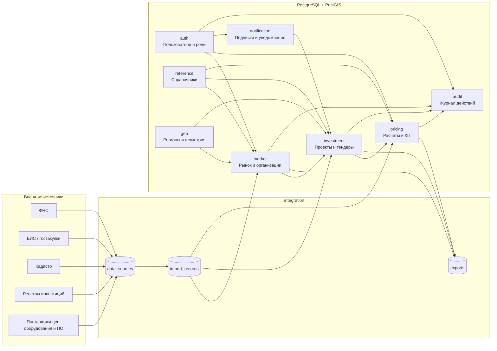
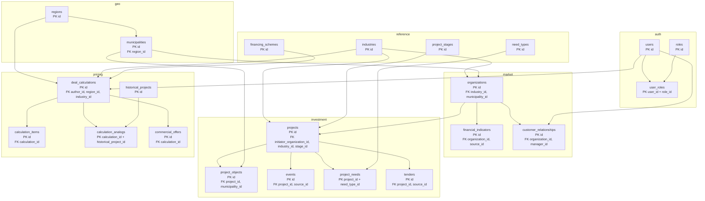
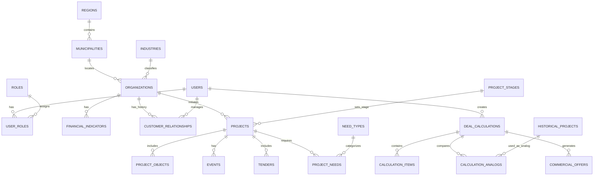

# Физическая модель базы данных

## Назначение

Модель поддерживает три модуля экосистемы: «Радар присутствия», «Инвестиционный навигатор» и «Калькулятор сделок». Основное хранилище — PostgreSQL с PostGIS; внешние государственные и коммерческие источники загружаются через API/ETL в контур приложения и не имеют прямых внешних ключей к нашей БД.



## Карта схем и таблиц



## Связи предметной области



## Направление связей

```text
regions 1 ─── N municipalities 1 ─── N organizations
organizations 1 ─── N financial_indicators
organizations 1 ─── N customer_relationships
organizations 1 ─── N projects 1 ─── N project_objects
                                  ├── N events
                                  ├── N tenders
                                  └── N project_needs N ─── 1 need_types

users 1 ─── N deal_calculations 1 ─── N calculation_items
                                     ├── N calculation_analogs N ─── 1 historical_projects
                                     └── N commercial_offers
```

## Правила целостности

- У организации один ИНН: `UNIQUE (inn)`.
- У финансового показателя одна запись на организацию, год и источник: `UNIQUE (organization_id, reporting_year, source_id)`.
- Один источник не может повторно загрузить тот же тендер: `UNIQUE (source_id, external_number)`.
- Одна подписка может содержать много условий; удаление подписки каскадно удаляет её условия.
- Удаление инвестиционного проекта каскадно удаляет его объекты, события, потребности и связи с аналогичными сущностями.
- Удаление расчёта каскадно удаляет позиции расчёта и привязки к аналогам; коммерческое предложение удалять каскадно нельзя, если оно уже отправлено клиенту.
- Файлы DOCX и экспортируемые CSV хранятся в объектном хранилище. В БД сохраняется только ключ объекта `document_storage_key` или `storage_key`.

## Критичные индексы

```text
market.organizations(inn)
market.financial_indicators(organization_id, reporting_year DESC)
investment.projects(stage_id, industry_id, started_on)
investment.events(project_id, occurred_at DESC)
investment.tenders(published_at DESC, deadline_at)
pricing.historical_projects(industry_id, region_id, project_type)
notification.notifications(user_id, read_at, created_at DESC)
GIST-индексы: boundary и location во всех пространственных таблицах
```
